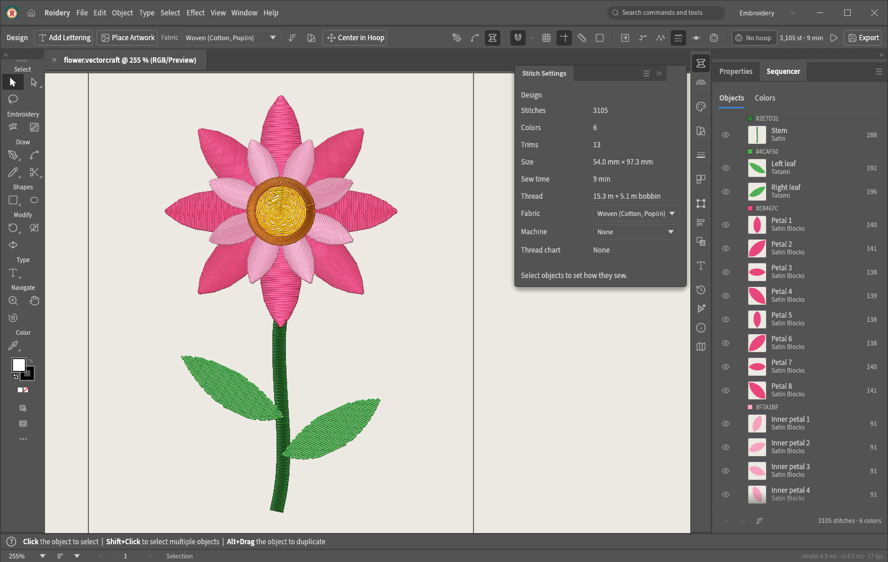

<p align="center">
  
</p>

<h1 align="center">Roidery</h1>

<p align="center">
  <b>Embroidery digitizing with an Adobe Illustrator style workflow.</b><br>
  Free, open source, and written in pure Rust.
</p>

<p align="center">
  
</p>

Roidery turns artwork into machine embroidery. Draw shapes or open an SVG, give each object a
stitch type, watch it sew as realistic thread, and export a file your machine reads. The defaults
are sensible, so a first design takes minutes; every stitch setting is still there when you want
control.

It runs on Windows, macOS and Linux, and is built on
[VectorCraft](https://github.com/storytold/vectorcraft), a full vector illustration app, so the
drawing tools are the real thing.

> [!NOTE]
> Roidery is early software. It sews real designs today, but expect rough edges and test-sew
> before running a production job.

## What it does

**Stitches**
- Tatami fill with underlay, plus gradient, contour, circular, motif and guided fills
- Satin columns that follow a path (and taper with the Width tool), and **Satin Blocks**: two
  rails with rungs you can drag, add and delete
- Running stitch (single, double, triple), E-stitch for appliqué, rope, and manual stitches
- **Convert to Satin** turns a filled shape into satin columns along its centre line
- **Fill Angle tool**: drag across a fill and its rows follow the line
- **Image Trace** on the Embroidery bar turns a placed picture into tatami-filled shapes in one
  click

**Lettering**
- Roidery Sans, an original satin font, plus the digitized community fonts from
  [Ink/Stitch](https://github.com/inkstitch/inkstitch-fonts) (optional download)
- Any installed computer font, sewn as fill lettering
- Text on a path, with height and spacing in millimetres

**Planning and checking**
- The **Sequencer** lists objects and colour blocks in sewing order; drag to reorder or Sort by
  Color to cut thread changes
- Automatic tie-ins, tie-offs, trims and jumps, with each object starting near where the last one
  ended
- **Remove Overlaps** cuts fills hidden under later ones
- Density map, stitch count, sew time and thread usage
- Hoops for Brother, Baby Lock, Janome, Bernina, Husqvarna Viking, Pfaff, Singer and commercial
  machines, with a fit check
- Fabric presets (woven, knit, piqué, terry, fleece, denim, twill, leather) that set density,
  pull compensation and underlay

**Seeing it before you sew**
- Vector, Stitch and **Realistic** views; the realistic view draws every stitch as lit, twisted
  thread on the GPU
- **Sew-Out Player** sews the design stitch by stitch
- **Mockups** on a T-shirt, cap, tote or fabric swatch, saved as PNG or JPEG for a customer
- A one-page production **worksheet** (PDF, PNG or SVG)

**Files**
- Export: Tajima DST and TAP, Brother PES, Janome JEF, Melco EXP, Husqvarna Viking VP3, Singer XXX,
  Barudan U01
- Open for editing: all of the above plus Barudan DSB, ZSK DSZ and Husqvarna Viking HUS
- Brother and Janome thread charts built in, or import your own (GIMP palette or CSV), with
  Match to Chart

## Getting started

Roidery is built from source for now. You need [Rust](https://rustup.rs) 1.95 or newer.

```sh
git clone https://github.com/lork-fork/roidery.git
cd roidery
cargo run --release -p vectorcraft
```

The app opens in the **Embroidery workspace** with hoop sizes on the Home screen. A first design:

1. Pick a hoop, then draw a shape (or File › Open an SVG).
2. Choose a stitch type in **Stitch Settings** or the bar across the top.
3. Press **Ctrl+Y** (Cmd+Y on a Mac) to cycle Vector, Stitch and Realistic views.
4. **File › Export Machine File…** and pick your machine's format.

The crates and binaries keep VectorCraft's names (`vectorcraft`, `vectorcraft-cli`) so upstream
changes merge cleanly; the app itself is called Roidery.

### Embroidery font library (optional)

The digitized Ink/Stitch fonts aren't in this repository. To package the ones whose licences
allow redistribution:

```sh
git clone https://github.com/inkstitch/inkstitch-fonts.git ../inkstitch-fonts
cargo run --release -p roidery-fonts --example package_library -- ../inkstitch-fonts/src embroidery-fonts
```

Roidery finds an `embroidery-fonts` folder beside the program, or wherever
`ROIDERY_EMBROIDERY_FONTS` points.

### Headless and scripting

```sh
# SVG to DST without opening a window
cargo run --release -p vectorcraft-cli -- run --in art.svg --cmd select.all \
  --cmd stitch.export --params '{"path":"art.dst"}'
```

Every menu command can be driven from scripts, the JSON control channel or an MCP client; see
[`docs/control-protocol.md`](docs/control-protocol.md) and [`docs/mcp.md`](docs/mcp.md).

## For developers

[`ROIDERY.md`](ROIDERY.md) maps what Roidery adds to VectorCraft: the `roidery-*` crates
(machine formats, stitch generators, stitch planning, mockups, fonts) and the small, contained
changes in VectorCraft's own crates. [`docs/development.md`](docs/development.md) covers building
and testing; `cargo xtask ci` runs formatting, clippy, tests and the asset and layering checks.

Contributions are welcome. Please keep the clean-room rule from [`AGENTS.md`](AGENTS.md): nothing
copied from commercial software or from GPL/AGPL code (Ink/Stitch's code included), and every new asset gets a row in
[`ASSETS.md`](ASSETS.md).

## License and credits

Roidery is dual-licensed under [MIT](LICENSE-MIT) or [Apache-2.0](LICENSE-APACHE), at your option,
the same terms as VectorCraft.

- **[VectorCraft](https://github.com/storytold/vectorcraft)**, Copyright (c) 2026 ArtCraft Team
  and the VectorCraft contributors (MIT OR Apache-2.0). Roidery is a fork of it. VectorCraft's
  ArtCraft name, wordmark and logos are trademarks of the ArtCraft Team and are not part of
  Roidery.
- **[pyembroidery](https://github.com/EmbroidePy/pyembroidery)** (MIT, Tatarize): the Brother and
  Janome thread colour tables. Roidery's machine-file code is its own; pyembroidery was used to
  check exported files.
- **[Ink/Stitch fonts](https://github.com/inkstitch/inkstitch-fonts)**: the optional font library
  is read from Ink/Stitch's published font format, and each font keeps its own licence (OFL,
  CC-BY, CC-BY-SA or public domain). No Ink/Stitch code is used.
- **Lucide** icons (ISC), and the **Source Sans 3**, **Source Serif 4**, **Inter** and
  **JetBrains Mono** fonts (SIL OFL 1.1).

Required notices are in [NOTICE](NOTICE), and every bundled asset is listed with its author,
source and licence in [ASSETS.md](ASSETS.md).

<sub>Brand names of embroidery machines and file formats are trademarks of their owners and are
used only to say which files and hoops Roidery supports. Adobe and Illustrator are trademarks or
registered trademarks of Adobe Inc. Roidery is an independent project and is not affiliated with,
sponsored by or endorsed by any of them.</sub>
